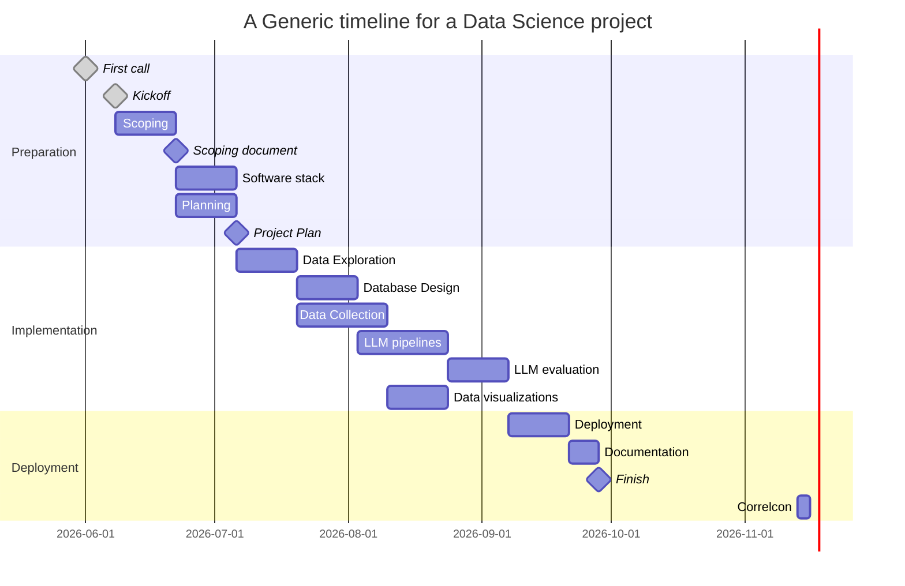

# UN LLM Analysis

[](https://cookiecutter-data-science.drivendata.org/)
[](https://correlaid.org/en/)
[](https://www.un.org/sg/en/content/noon-briefing-highlight)
[](https://github.com/users/darenasc/projects/6/views/2)
[](https://github.com/darenasc/correlaid-mentoring-project/issues)

Analysis of the language patterns and themes in [UN noon briefings](https://www.un.org/sg/en/content/noon-briefing-highlight) using large language models (LLMs). This project aims to identify trends and insights on global issues, policy developments, and emerging challenges, facilitating more informed decision-making and analysis.

> **Note**: The communications about the project are in the 
> `#mentoring-project` channel on Correlaid's Slack.

## Usage

Requirements:

- [Python 3.12](https://www.python.org/downloads/release/python-31213/)
- [`pipenv`](https://pipenv.pypa.io/en/latest/)

```bash
git clone git@github.com:darenasc/correlaid-mentoring-project.git
cd correlaid-mentoring-project
pipenv shell
pipenv install -d Pipfile
```

See the [CONTRIBUTING](./CONTRIBUTING.md) document to setup the environment and 
start contributing to the project.

## Design

- [Slides from the first meeting on 08.06.2026 "Volunteer Project Correlaid"](https://docs.google.com/presentation/d/1eMzWXqI4xPCCzbhxbL_EYkOfEE-uKAT6_fdOmvRROlI/edit?usp=sharing)
- [Scoping Document](https://docs.google.com/document/d/1BXssHaiz7N6zIianLfSOAW3zsMlipRtTeRzJ5Ryj-jA/edit?usp=sharing) based on [Data Science Project Scoping Guide](https://datasciencepublicpolicy.org/our-work/tools-guides/data-science-project-scoping-guide/)

## Planning

A generic data science project will look like the following. In theory, the 
implmentation part is planned to last between 4 to 10 weeks. The Gantt chart 
shows dependencies that, in practice, can progress in parallel with 
communication among the assigned people.



## Resources

- [Noon briefing highlight](https://www.un.org/sg/en/content/noon-briefing-highlight)
- [Data Science for Social Good Curriculum](https://dssg.github.io/hitchhikers-guide/curriculum/) with data science teaching material of multiple topics
- Git
  - [Learn git branching](https://learngitbranching.js.org) is an app to learn the basics of working with git
  - [Git feature branch workflow](https://www.atlassian.com/git/tutorials/comparing-workflows/feature-branch-workflow) blogpost about a recommended way of working with git in collaborative projects
  - [pre-commit](https://pre-commit.com) library to help with the maintainability of the repository
- Web scraping
  - [Beautiful Soup Documentation](https://beautiful-soup-4.readthedocs.io/en/latest/#) library to parse `HTML` code
  - [Beautiful Soup tutorial](https://realpython.com/beautiful-soup-web-scraper-python/)
  - [Another BeautifulSoup and Requests tutorial](https://medium.com/geekculture/part-1-crawling-a-website-using-beautifulsoup-and-requests-413ffb29dd8e)
- LLM
  - [Ollama](https://ollama.com/download) software to serve large language models locally
  - [Ollama in Colab notebook](https://colab.research.google.com/github/5aharsh/collama/blob/main/Ollama_Setup.ipynb), [medium article](https://medium.com/@abonia/running-ollama-in-google-colab-free-tier-545609258453)
  - [langchain](https://docs.langchain.com/oss/python/langchain/overview) framework to create and operate agents
  - [Introduction to langchain Python 1h course](https://academy.langchain.com/courses/foundation-introduction-to-langchain-python)
  - [dspy](https://dspy.ai/getting-started/program-dont-prompt/) library to structure prompts to work with LLMs
- Model evaluation
  - [mlflow evaluation](https://mlflow.org/docs/latest/genai/eval-monitor/quickstart/) library with useful features when evaluating LLM results
- Databases
  - [sqlite3](https://realpython.com/ref/stdlib/sqlite3/) lightweight database included in Python.
  - [sqlialchemy](https://docs.sqlalchemy.org/en/21/dialects/sqlite.html) library to interact with databases.
- Data visualization
  - [plotly](https://plotly.com/python/) to create plots and charts
  - [plotly dash](https://dash.plotly.com/) to create dashboards using plotly
- Testing
  - [`pytest`](https://docs.pytest.org/en/stable/) framework for testing in Python.
- Front-end
  - [`streamlit`](https://streamlit.io) library to create web apps in a few steps
  - [`gradio`](https://gradio.app) library, similar to streamlit, to create graphical user interfaces with programs
- Documentation
  - [mkdocs](https://www.mkdocs.org) library to generate documentation
  - [Make a README](https://www.makeareadme.com) how to write a `README`
  - [Keep a Changelog](https://keepachangelog.com/en/1.1.0/) how to maintain a `CHANGELOG.md` for the project
  - [Contributing guidelines](https://docs.github.com/en/communities/setting-up-your-project-for-healthy-contributions/setting-guidelines-for-repository-contributors) information from GitHub
  - [mermaid](https://mermaid.js.org/intro/) for markdown diagrams, useful to include in READMEs and documentation
- Deployment
  - [GitHub CI/CD](https://github.com/resources/articles/ci-cd) continuous integration and continuous deployment or delivery overview
  - [GitHub actions](https://github.blog/enterprise-software/ci-cd/build-ci-cd-pipeline-github-actions-four-steps/) how to use GitHub actions to implement a pipeline for CI/CD
  - [`streamlit` Community deployment](https://docs.streamlit.io/deploy/tutorials) option for an app created with streamlit
- IDE and extensions
  - [Visual Studio Code](https://code.visualstudio.com) using vscode is optional, if you have a preferred IDE you can use it for the project
  - [autoDocstring](https://marketplace.visualstudio.com/items?itemName=njpwerner.autodocstring) Automatic docstring generation
  - [Markdown Preview Mermaid Support](https://marketplace.visualstudio.com/items?itemName=bierner.markdown-mermaid) to support mermaid in markdown files
  - [Prettier - Code formatter](https://marketplace.visualstudio.com/items?itemName=esbenp.prettier-vscode) Code formatter
  - [Python](https://marketplace.visualstudio.com/items?itemName=ms-python.python) Python extension for vscode
  - [SandDance for VSCode](https://marketplace.visualstudio.com/items?itemName=msrvida.vscode-sanddance) To explore data
  - [Todo Tree](https://marketplace.visualstudio.com/items?itemName=Gruntfuggly.todo-tree) Show TODO, FIXME, etc. comment tags in a tree view.

## Project Organization
<!-- autogenerated with cookiecutter-data-science, it will likely be removed towards the end of the project -->
```
├── LICENSE            <- Open-source license if one is chosen
├── Makefile           <- Makefile with convenience commands like `make data` or `make train`
├── README.md          <- The top-level README for developers using this project.
├── data
│   ├── external       <- Data from third party sources.
│   ├── interim        <- Intermediate data that has been transformed.
│   ├── processed      <- The final, canonical data sets for modeling.
│   └── raw            <- The original, immutable data dump.
│
├── docs               <- A default mkdocs project; see www.mkdocs.org for details
│
├── models             <- Trained and serialized models, model predictions, or model summaries
│
├── notebooks          <- Jupyter notebooks. Naming convention is a number (for ordering),
│                         the creator's initials, and a short `-` delimited description, e.g.
│                         `1.0-jqp-initial-data-exploration`.
│
├── pyproject.toml     <- Project configuration file with package metadata for 
│                         un_llm_analysis and configuration for tools like black
│
├── references         <- Data dictionaries, manuals, and all other explanatory materials.
│
├── reports            <- Generated analysis as HTML, PDF, LaTeX, etc.
│   └── figures        <- Generated graphics and figures to be used in reporting
│
├── requirements.txt   <- The requirements file for reproducing the analysis environment, e.g.
│                         generated with `pip freeze > requirements.txt`
│
├── setup.cfg          <- Configuration file for flake8
│
└── un_llm_analysis   <- Source code for use in this project.
    │
    ├── __init__.py             <- Makes un_llm_analysis a Python module
    │
    ├── config.py               <- Store useful variables and configuration
    │
    ├── dataset.py              <- Scripts to download or generate data
    │
    ├── features.py             <- Code to create features for modeling
    │
    ├── modeling                
    │   ├── __init__.py 
    │   ├── predict.py          <- Code to run model inference with trained models          
    │   └── train.py            <- Code to train models
    │
    └── plots.py                <- Code to create visualizations
```

--------

