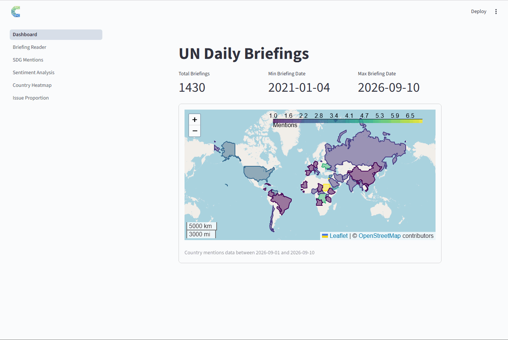

# UN LLM Analysis

[](https://cookiecutter-data-science.drivendata.org/)
[](https://correlaid.org/en/)
[](https://www.un.org/sg/en/content/noon-briefing-highlight)
[](https://github.com/users/darenasc/projects/6/views/2)
[](https://github.com/darenasc/correlaid-mentoring-project/issues)

Analysis of the language patterns and themes in [UN noon briefings](https://www.un.org/sg/en/content/noon-briefing-highlight) using large language models (LLMs). This project aims to identify trends and insights on global issues, policy developments, and emerging challenges, facilitating more informed decision-making and analysis.


## Getting Started

### Requirements

- [Python 3.12](https://www.python.org/downloads/release/python-31213/)
- [`uv`](https://docs.astral.sh/uv/#installation)


### Installation

```bash
git clone https://github.com/darenasc/correlaid-mentoring-project.git
cd correlaid-mentoring-project

# Create the virtual environment and install dependencies
uv sync

# Install playwright to crawl the briefings data
uv run playwright install
```

Use `uv run <command>` to execute commands in the project's virtual environment; or activate the virtual environment manually with `source .venv/bin/activate` (Linux/macOS).

See the [CONTRIBUTING](./CONTRIBUTING.md) guide to set up the development environment and start contributing to the project.


### Command-line interface (CLI)

The `briefings` CLI provides commands for downloading, storing, and querying UN noon briefings.

```bash
# Activate virtual environment to run the commands below
# On Unix/macOS:
source .venv/bin/activate

# On Windows:
.venv\Scripts\activate

# Deactivate virtual environment
deactivate
```

#### Scraping briefings

Download UN noon briefings and save them as JSON files.

```bash
# Download briefings within a date range
briefings update 2026-08-01 2026-08-12

# Download briefings since a given date
briefings update --since 2026-08-01
```

Downloaded JSON files are stored in:

 - `data/raw/briefings/YYYY/YYYY-MM/YYYY-MM-DD.json`

#### Managing the database

Initialize, load, and query the SQLite database.

```bash
# Initialize the database
briefings init-db

# Load briefings into the database
briefings load 2026-08-01 2026-08-12

# Query briefings
briefings query --date 2026-08-12
briefings query --status available

# Show database statistics
briefings stats
```

Use `briefings --help` or `briefings <command> --help` for more options.


## Analysis

The project uses LLMs to analyze UN noon briefings, focusing on:

- **SDG Mentions:** Identifying references to the UN Sustainable Development Goals (SDGs).
- **Sentiment Analysis:** Classifying the sentiment and tone of briefing sections.
- **Country Heatmap:** Visualizing country mentions using maps and heatmaps.
- **Issue Proportion:** Tracking major global issues and their trends over time.

Exploratory analyses, LLM experiments, and visualizations are available in the [Jupyter notebooks](./notebooks/).


## Dashboard

The project includes a Streamlit dashboard for exploring UN noon briefings and their analysis results.

Run the following command from the terminal to launch it.

```bash
streamlit run app/Dashboard.py
```

The app will be running locally in http://localhost:8501


**A Short Demo:**




## Documentation

The project documentation is built with [MkDocs](https://www.mkdocs.org/).

To view the documentation locally, run:

```bash
mkdocs serve -f docs/mkdocs.yml
```

The documentation will be available in http://127.0.0.1:8000/ in your browser.

See the [Usage](./docs/docs/index.md) guide for the setup instructions.


## Project Organization

```
.
├── app/                     # Streamlit dashboard
│   └── pages/               # Dashboard pages
├── database/                # Database schema
├── docs/                    # MkDocs documentation
├── figures/                 # Documentation images
├── notebooks/               # Exploratory analysis
├── scripts/                 # Utility scripts
├── tests/                   # Automated tests
├── un_llm_analysis/         # Core Python package
│   ├── analysis/            # Analysis modules
│   ├── database.py          # Database operations
│   ├── extractor.py         # Briefing extraction
│   ├── main.py              # CLI entry point
│   └── scraper.py           # Web scraping
├── CHANGELOG.md             # Version history
├── CODE_OF_CONDUCT.md       # Community guidelines
├── CONTRIBUTING.md          # Contribution guidelines
├── LICENSE                  # Software license
├── Makefile                 # Development commands
├── pyproject.toml           # Package and tool configuration
├── README.md                # Project overview
└── uv.lock                  # Locked dependency versions
```


--------

## Contributors

**Volunteers**: [Charles Mbayo](https://github.com/MathCodeLab1), [Daniel Wilkinson](https://github.com/daniel-lee-wilkinson), [Franz Song](https://github.com/yuanhes), [Josmy Mathew](https://github.com/josmyrose), and [Roxana Runcan](https://github.com/Roxana-Runcan)

**Mentor**: [Diego Arenas](https://github.com/darenasc)

**Project Partner**: [CorrelAid](https://correlaid.org/en/)
