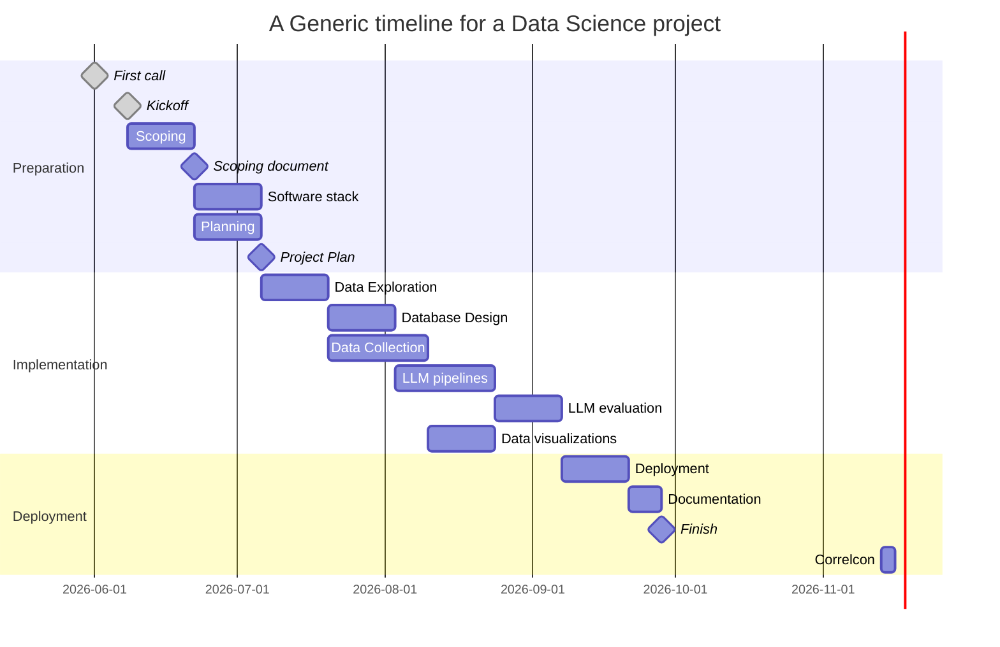

# Project Planning

## Scoping

- [Slides from the first meeting on 08.06.2026 "Volunteer Project Correlaid"](https://docs.google.com/presentation/d/1eMzWXqI4xPCCzbhxbL_EYkOfEE-uKAT6_fdOmvRROlI/edit?usp=sharing)
- [Scoping Document](https://docs.google.com/document/d/1BXssHaiz7N6zIianLfSOAW3zsMlipRtTeRzJ5Ryj-jA/edit?usp=sharing) based on [Data Science Project Scoping Guide](https://datasciencepublicpolicy.org/our-work/tools-guides/data-science-project-scoping-guide/)

## Timeline

A generic data science project will look like the following. In theory, the
implementation part is planned to last between 4 to 10 weeks. The Gantt chart
shows dependencies that, in practice, can progress in parallel with
communication among the assigned people.

